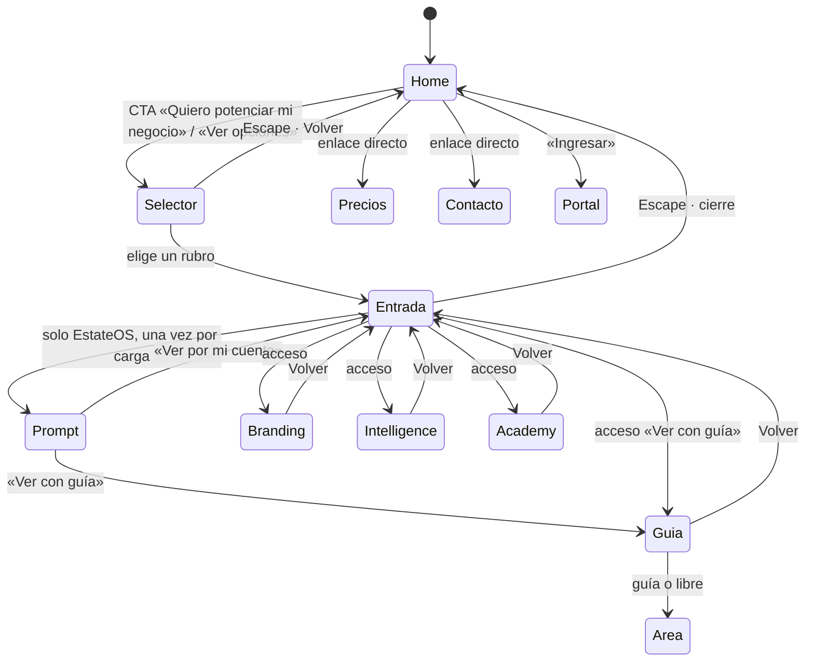

# Lote 1.1 · Arquitectura y wireflows

**Fecha:** 26/10/2026 · **Modelo configurado y efectivo:** `claude-sonnet-5-5`, esfuerzo `high` (`get_session`) · **Rama:** `claude/eclipse-v3-inventory-audit-2ukttn` · **Resultado:** **documental**. No se modificó código de producto, no se instaló nada, gasto externo USD 0. Todo lo que dice «propuesto» **no existe** en el código.
**Estado:** **aceptado con las decisiones D1–D5 de Ignacio (26/10/2026)**; ver §11.
**Fuente del lote:** Notion «Lote 1.1 · Arquitectura y wireflows» (última edición 26/10/2026 12:11 UTC), «Lote 4.2» (para el alcance del selector) y las decisiones de Ignacio registradas en `auditoria-0.1-estado-real.md` §15–§24. Evidencia: **E1** (código y documentos leídos, nada ejecutado). El criterio de 5 personas **no se declara pasado** (§10).

## 0. Informe en tres líneas

- **Qué cambió:** quedan escritos el **mapa de contenidos** (todo lo vigente tiene destino, §3 y §4), los **wireflows desktop y móvil** por estado con entrada, acción, salida, error, vacío y recuperación (§6), el **contrato de URL** `?rubro&vista&area` con lista blanca (§5), el **propietario único de History** y las reglas de foco y Escape (§7), el contenido **sin JS** (§8) y el **protocolo de usabilidad** de 5 personas (§9).
- **Qué quedó abierto:** las 5 decisiones D1–D5 **se resolvieron el 26/10/2026** (§11). Quedan dos consecuencias: **qué reemplaza los botones de las tarjetas de plan y de «Pieza por pieza»** ahora que el armador está dormido (D6), y **qué demo respalda el acceso «Ver con guía» de Ecommerce** (D7). La prueba con 5 personas, el HTML exportado sin JS y las capturas del HEAD **no se ejecutaron** (E2 → 1.5).
- **Qué necesita el OK de Ignacio:** D6 y D7 (§11). Habilita **1.4** (dirección visual) y no 1.2/1.3 todavía: el orden maestro es 1.1 → 1.4 → 1.2 → 1.3 → 1.5.

## 1. Registro de entrada (G0)

| Dato | Valor | Cómo se obtuvo |
|---|---|---|
| Modelo y esfuerzo efectivos | `claude-sonnet-5-5` · `high`; sin Max ni workflows; Opus: 0 | `get_session` |
| Rama, HEAD al abrir | `claude/eclipse-v3-inventory-audit-2ukttn` · `181be67`; `git status --short` vacío | `git` |
| `main` de Eclipse-Web | `6bf91ae` (igual que la base de la auditoría del 23/10) | `git rev-parse origin/main` |
| Delta contra la base de Notion | Código de aplicación sin cambios desde `6bf91ae`; sobre esa base solo se agregaron `docs/v3/`, `.claude/skills/` y una sección de `CLAUDE.md` (PR #15, borrador) | `git diff --stat origin/main..HEAD` |
| Skills de proyecto | Las 9 aparecen enumeradas por el cliente en esta sesión (nombre y descripción). **No se usaron**: el lote es documental. El *smoke* de comportamiento queda para el primer lote que las use (1.4) | observado |
| Fuentes leídas | `app/[locale]/page.tsx`, `app/page.tsx`, `components/ui/sectionIndex.ts`, `components/layout/{navLinks.ts,Header.tsx,Footer.tsx,SmoothAnchors.tsx,LocaleSwitcher.tsx}`, `components/demo-experience/{store.ts,DemoExperienceHost.tsx}`, `components/hero/{Hero,VerticalChips}.tsx`, `components/pricing/BuyTabs.tsx`, `components/motion/{LazyHydrate,ContentVisibilitySync,Reveal}.tsx`, `components/loader/Loader.tsx`, `components/sections/founders/FoundersSection.tsx`, `content/*.json`, `docs/v3/inventario.md` y la auditoría 0.1 | lectura |
| Límites | No se ejecutó la aplicación, el build ni tests; no se exportó el HTML; no se abrieron las demás secciones archivo por archivo (se usó la auditoría 0.1 como inventario de base, sin repetirla). `node_modules` no está instalado y no se instaló para leer | — |

**Precedencia usada.** Instrucción expresa de Ignacio (registrada en la auditoría) → Notion «Eclipse v3» y el prompt de 1.1 → `CLAUDE.md` → skills. Donde Notion y Ignacio difieren, gana Ignacio y se anota abajo.

## 2. Decisiones y conflictos resueltos

| # | Tema | Fuentes en conflicto | Resolución usada en este lote |
|---|---|---|---|
| R1 | Rubros del selector (resuelto con D1) | Notion 1.1 y 4.2: solo Inmobiliarias y Ecommerce · Ignacio 24/10 (§20.3): cinco rubros · Ignacio 26/10 (§22.4): **empezar con Inmobiliarias y Ecommerce**, sumar los demás cuando tengan micrositio | **Dos rubros.** Ecommerce es **un apartado propio con sus planes**, parecido a «Eclipse · EstateOS» (D1). Los demás (salud y animales, restaurantes/bodegones, compliance) se agregan después, solo cuando exista su micrositio; nunca como enlace a algo inexistente |
| R2 | «Armá tu plan» (resuelto con D2) | `CLAUDE.md` (header: secundario) · Ignacio 26/10: «no existe»; el botón «Quiero potenciar mi negocio» lleva al **cuestionario modal** | «Armá tu plan» **sale del header, del menú móvil, del footer y de los chips del hero**. El armador (`/plan` y el overlay `openBuilder`) queda **dormido** (D2): no se borra ni se muestra; más adelante se transformará en el flujo de **pago con link**. Ver §3.1 fila 17 y D6 |
| R3 | CTA primario | `CLAUDE.md`: «Pedí tu demo» · Notion 1.2 y Ignacio 24/10: «Quiero potenciar mi negocio» (primario) y «Ver opciones» (secundario), ambos abren el selector | Se usa el CTA nuevo. `CLAUDE.md` y los tests que citan «Pedí tu demo» se actualizan en 1.2/1.3 (§12) |
| R4 | Memoria del visitante | `CLAUDE.md`: «nada se recuerda» · Ignacio: en **EstateOS** el modal aparece **en cada recarga**; «Ver con guía» activa el teaser, que guarda «visto» en `localStorage` y no se repite solo salvo que el usuario pida verlo desde cero | **Sin memoria (D3):** el modal aparece en cada recarga, así que **no hace falta ninguna variable «visto»**. No se usa `localStorage` ni `sessionStorage` para esto: rige `CLAUDE.md` sin excepción. Reemplaza lo registrado en la auditoría §17.2 y §20.1 y en la propuesta de clave `eclipse:estateos:intro-seen:v1` |
| R5 | Qué es el «teaser» | Ignacio: «Ver con guía activa el teaser completo» · el teaser audiovisual no existe todavía (3.1–3.5) | Hasta que exista, «Ver con guía» abre la **guía actual de Lumen** (6 pasos, `components/demos/real-estate/tour.ts`). El teaser se enchufa en 3.5 sin cambiar el contrato |
| R6 | Dónde se pregunta «guía o por mi cuenta» (solo EstateOS) | Hoy la capa de demo lo pregunta **en cada apertura** · Ignacio: el modal de EstateOS lo pregunta **en cada recarga** | Se pregunta **una vez por carga de página** (la respuesta vive en memoria, nunca en storage). Si el visitante responde en el prompt de EstateOS, la capa de demo **no lo vuelve a preguntar** en esa carga; una URL directa a la demo sí lo pregunta (la guía nunca arranca sola) |
| R7 | Gateway | Notion: exactamente cuatro accesos, «Por mi cuenta» secundario dentro de guía | Cuatro accesos: **Ver con guía · Branding · Intelligence · Academy**. «Ver por mi cuenta» es la salida libre de la guía. Son **modos de demo**, no las cinco líneas de servicio |
| R8 | Demos ocultas | `docs/v3/inventario.md`: todo contenido v2 sigue alcanzable · Ignacio (§20.4, §22.4): clinic, gym, restaurant, academy y Bruma quedan **ocultas en standby dentro de Eclipse-Web** | **Standby = no se muestran, no se borran** (código, copy, tests y registry intactos). El inventario histórico queda reemplazado en esto, con fuente y fecha |
| R9 | Orden del lote siguiente | Notion 1.1: «habilita 1.2 y 1.3» · Orden maestro y Fase 1: 1.1 → 1.4 → 1.2 → 1.3 → 1.5 | Manda el orden maestro: sigue **1.4** |
| R10 | Catálogos | Ignacio: tres catálogos separados | 1.1 **no cambia precios**. Las pantallas de EstateOS no muestran el catálogo general ni al revés. 199 general sin publicar; Contact = web básica sin chat |

## 3. Mapa de contenidos: tabla origen → destino

**Estados:** `vigente` (sigue igual) · `plegado` (sigue, menos visible) · `reubicado` · `standby` (oculto, conservado) · `propuesto` (nuevo, no existe) · `histórico` (inactivo). **JS:** «no» = el contenido está en el HTML servido (E1, por lectura; la verificación del HTML exportado queda para 1.5, §8).

### 3.1 Rutas y bloques de la home

| # | Origen (id · archivo) | Destino v3 | Estado | Requiere JS | Nota |
|---|---|---|---|---|---|
| 1 | Raíz `/` · `app/page.tsx` (elige idioma) | Sin cambio | vigente | sí (elige idioma); con `<noscript>` va a `/es/` | **Conserva `location.search` y `location.hash`** (línea 34): el contrato de URL sobrevive a la redirección. El `<noscript>` pierde la query |
| 2 | Loader · `components/loader/Loader.tsx` | Sin cambio (no hay loader nuevo) | vigente | sí | `aria-hidden`, se salta con click/tecla/rueda/touch, no corre en `/portal`; **no se le suma espera a medios**. Entrada directa a una vista de showroom: sin cine nuevo |
| 3 | Hero `#inicio` · promesa, eyebrow, H1, subtítulo | Home A (§4) | vigente | no | El H1 queda como LCP; no se toca el texto en este lote |
| 4 | Hero · CTA «Pedí tu demo» (`DemoCta origin=hero`, `data-hero-cta`) | «Quiero potenciar mi negocio» → abre el **selector** | reubicado (R3) | sí (abre modal) | **Hoy `DemoCta` es un enlace real a WhatsApp** (E1: `DemoCta.tsx` usa `WhatsAppLink`). El CTA nuevo debe ser **un `<a>` con `href` real** (propuesta: `#contacto`, donde está WhatsApp) mejorado por JS para abrir el selector; si fuera solo un `<button>`, sin JS se pierde el contacto. Un solo CTA ámbar sólido por viewport se mantiene |
| 5 | Hero · chips por rubro (`VerticalChips`: 7 claves) | El **selector de dos rubros** reemplaza a las siete claves | reubicado | sí | Las 5 claves ocultas siguen en `content/verticals.json` y el registry. «Otro» **desaparece** (D5): quien no encaja usa el contacto directo |
| 6 | Corona, `SkyTransition` ×2, `EphemerisRail` | Sin cambio | vigente | sí (decorativo) | — |
| 7 | `#ejemplos` · 6 demos: Aurora, Lumen, Órbita, Bruma, Lucero, Atrio | Vitrina con **Lumen (Inmobiliarias)** y **Ecommerce (D1)** | Lumen vigente · otras 5 standby | la demo sí; el texto de la sección no | «Demo» visible en toda marca ficticia. Las 5 en standby conservan imports lazy, namespaces, guías, tests y trailers |
| 8 | Capa «Ver demo» · `DemoExperienceHost` (`<dialog>`, una demo a la vez) | **Contenedor único del showroom**: el mismo `<dialog>` cambia de vista; no se apilan modales | vigente (ampliado) | sí | Hoy empuja un `pushState` con `{eclipseDemo}` a la misma URL (§7) |
| 9 | `#servicios` · 6 familias y 20 piezas (`content/items.json`) | Home B «Qué ofrecemos»: las **cinco líneas** (SaaS, Agency, Studio, Academy, Equipamiento; Intelligence transversal) y packs arriba; las 6 familias y 20 piezas **plegadas debajo** | plegado (el copy de las líneas lo define 2.1) | no | Sin precios ni «Sumar» en esta sección (regla v3); las líneas **no existen hoy en `messages`** (solo hay una demo llamada Academy) |
| 10 | `#precios` · tabs «Paquetes» / «Pieza por pieza» (`BuyTabs`) | Sin cambio de contenido: Adaptación de producto y Pack lanzamiento (`content/plans.json`), 20 piezas con precio independiente y de complemento, mantenimiento 30/75/150 (terceros 5/15/40 dentro, 2 h/mes), seña 50/50 | vigente | **precio: ver §8** | `#precios` responde a `hashchange` y abre la pestaña que contiene el ancla (E1: `BuyTabs.tsx`) |
| 11 | Catálogo EstateOS 30/75/100/150/200 y Partner 500 (propuesta) | Dentro del recorrido EstateOS (comparador de 2.3). **Desde `#precios` solo un enlace** «Planes para inmobiliarias» (propuesta) | propuesto | sí | **No se mezcla con el catálogo general** |
| 12 | Ofertas fundador, combo voz, anual, referidos (`content/offers.json`) | No se muestran como ofertas | histórico (`active: false` las 4) | — | Siguen en `offers.json` y `legacy.json` para leer acuerdos previos |
| 13 | `#problema` · calculadora de oportunidad + «Ver la cuenta» (`LossCalculator`) | Home C «Para tu PyME»: el problema primero; la cuenta plegada | plegado | sí | Es indicativa; su CTA de demo pasa a abrir el selector con el rubro precargado (propuesta) |
| 14 | `#proceso` · 5 etapas con plazo | Home F, sin cambio de contenido | vigente | no | «El proyecto arranca con la seña» se conserva |
| 15 | `#fundadores` · programa fundador | Conserva id y componente | vigente (la oferta está **histórica**) | no | `FoundersSection` solo dibuja el libro fundador si `founderOfferOpen(...)` (E1, línea 47); qué muestra hoy cerrado se define en 2.1 |
| 16 | `#contacto` · FAQ, condiciones, chat del agente (`AgentChat`, `MicButton`), cierre y `DemoCta final_cta` | Home F, sin cambio | vigente | FAQ/condiciones no; el chat sí | El CTA final es contacto directo |
| 17 | Armador `/[locale]/plan/` y overlay `openBuilder` (6 puntos de apertura: header, menú, `hero_other`, `plan_card`, `pricing`, `ProjectBlock`; más el botón genérico `BuildPlanButton`, usado también en el footer) | **Dormido (D2)**: se retiran **todos** los puntos de apertura visibles. Quedan intactos el código, `lib/pricing.ts`, `lib/plan-url.ts`, `RequestAction`, los tests y la ruta `/plan/` (sin enlaces; mantiene vivos los links de plan ya compartidos). Futuro: se transforma en el flujo de **pago con link** (sin lote asignado) | standby | sí | Consecuencia: las tarjetas de plan y «Pieza por pieza» pierden su botón de «Sumar/armar»; qué lo reemplaza es **D6**. La regla v3 «las piezas se suman solo en Precios y en el armador» queda en suspenso mientras el armador duerme |

### 3.2 Chrome y transversales

| # | Origen | Destino v3 | Estado | JS | Nota |
|---|---|---|---|---|---|
| 18 | Header: Servicios · Demos · Precios · Cómo trabajamos, CTA, «Armá tu plan», «Ingresar», preferencias | Los 4 enlaces **iguales**; CTA = «Quiero potenciar mi negocio»; **sin «Armá tu plan»**; «Ingresar» discreto a `/portal/`; idioma, moneda y sonido bajo **un** disparador | reubicado | enlaces `lg+` no · menú móvil sí | `NAV_LINKS` ids no cambian |
| 19 | Menú móvil (`MobileMenu`, `<dialog>`) | Mismo contenido que el header; el CTA es el mismo | vigente | **sí** | Sin JS, en < 1024 px no hay menú: se navega por scroll (§8) |
| 20 | Footer: navegación, WhatsApp, email, unidades Agency/Media/Market («Próximamente»), avisos de moneda y de demo | Sin cambio, salvo el enlace «Armá tu plan» (se retira) | vigente | no | Contacto sin cuenta |
| 21 | Preferencias: idioma es/en/pt, moneda USD/ARS/BRL, sonido (apagado por defecto) | Sin cambio | vigente | sí (moneda y sonido); el idioma es un enlace real | `LocaleSwitcher` **conserva la query** al cambiar de idioma (E1: `WithQuery`): el estado de showroom sobrevive; el hash no |
| 22 | `WhatsAppLink` (enlace real + tracking) | Sin cambio | vigente | **no** | Contacto utilizable sin JS (E1) |
| 23 | JSON-LD (Organization + un Service por plan) | Sin cambio | vigente | no | — |
| 24 | Enlace «saltar al contenido» → `#main` | Sin cambio | vigente | no | — |
| 25 | Portal cliente `/[locale]/portal/**` (9 rutas; demo y live) | Sin cambio; **nunca se le aplica estado de showroom** | vigente | según modo | Demo: fixtures «Demo», sin red; live: backend real |

### 3.3 Showroom nuevo (todo **propuesto**)

| # | Pieza | Qué es | Estado |
|---|---|---|---|
| 26 | Selector modal | 2 filas amplias: Inmobiliarias · Ecommerce (D1) | propuesto |
| 27 | Prompt de entrada de EstateOS | «Ver con guía» / «Ver por mi cuenta», una vez por carga | propuesto |
| 28 | Gateway de 4 accesos | Ver con guía · Branding · Intelligence · Academy | propuesto |
| 29 | Vista «guía» | La capa de demo real (Lumen) | **existente** |
| 30 | Vistas Branding, Intelligence, Academy | Presentaciones por producto | **faltantes** (3.x/4.2; hoy no hay contenido) |

## 4. Mapa de la home (bloques A–F)

Los **ids no cambian** (`CLAUDE.md`: anclas y enlaces compartidos dependen de ellos). Lo que se propone es el **orden de lectura** y qué entra en cada bloque.

| Bloque | Contenido | Ancla | Hoy en el código | Cambio propuesto |
|---|---|---|---|---|
| **A** | Loader + hero: promesa, un CTA | `#inicio` | `Hero` | CTA «Quiero potenciar mi negocio»; chips → selector |
| **B** | Qué ofrecemos: 5 líneas + packs | `#servicios` | `ServicesSection` (6 familias de piezas) | Líneas arriba, familias y piezas plegadas. **Copy: 2.1** |
| **C** | Para tu PyME: problema → solución | `#problema` | `ProblemSection` (calculadora) | Reubicar **antes** de precios (hoy está 5.º) |
| **D** | Selector de rubro | — (modal) | no existe | Se abre desde A (y desde B/C/F) |
| **E** | Precios y mantenimiento | `#precios` | `PricingSection` | Sin cambio de contenido |
| **F** | Demos · método · contacto | `#ejemplos` · `#proceso` · `#fundadores` · `#contacto` | `ExamplesSection`, `ProcessSection`, `FoundersSection`, `AgentSection` | Demos se vuelve la vitrina de dos rubros |

**Orden resultante de lectura:** A hero → B qué ofrecemos → C para tu PyME → E precios → F demos, método, fundadores y contacto. Hoy el orden es hero → demos → soluciones → precios → calculadora → método → fundadores → contacto.

**Dos opciones, para decidir en 1.2:**
- **Opción 1 (recomendada):** reordenar los **ids existentes** según A–F. Ventaja: respeta el pedido de Notion y llega antes a la pregunta «¿qué es esto para mi negocio?»; no crea ancla nueva. Riesgo: mover secciones diferidas cambia alturas y puede descolocar los saltos de ancla (regla de `CLAUDE.md`: «Hydration must not change heights»); se mide en 1.5.
- **Opción 2:** mantener el orden actual y solo plegar. Ventaja: riesgo mínimo. Desventaja: el selector y la demo quedan lejos del problema del visitante.

**Navegación directa** (sin cuenta ni selector): header y menú llevan a `#servicios`, `#ejemplos`, `#precios`, `#proceso`; el contacto está en `#contacto` y en el footer (WhatsApp y email); «Ingresar» va al portal. **Ninguno de esos caminos exige abrir el modal.**

## 5. Contrato de URL (propuesto, no implementado)

Sobre la página estática existente (`output: 'export'`, `trailingSlash: true`, `localePrefix: 'always'`, `basePath` configurable). Forma real: `<basePath>/<locale>/?rubro=…&vista=…&area=…`, por ejemplo `/Eclipse-Web/es/?rubro=inmobiliarias&vista=entrada`. No se crean rutas dinámicas ni páginas nuevas.

### 5.1 Parámetros y lista blanca

| Parámetro | Valores válidos | Significado |
|---|---|---|
| `rubro` | `inmobiliarias` · `ecommerce` (D1) | Producto elegido. Sin `rubro` no hay showroom |
| `vista` | `entrada` · `guia` · `branding` · `intelligence` · `academy` | `entrada` = gateway de 4 accesos; las otras son el acceso abierto |
| `area` | `recepcion` · `administracion` · `ventas` · `marketing` | Dónde aterriza la **guía** (solo con `vista=guia`) |

**Alias de Notion:** `area=branding|intelligence|academy` se **normalizan** a `vista=branding|intelligence|academy` (sin `area`). Es la forma canónica; los alias se aceptan al leer y no se escriben.

**Matriz de combinaciones**

| `vista` \ `area` | (sin area) | recepcion | administracion | ventas | marketing |
|---|---|---|---|---|---|
| `entrada` | ok | inválida | inválida | inválida | inválida |
| `guia` | ok (abre la capa y pregunta) | ok | ok* | ok | ok* |
| `branding` · `intelligence` · `academy` | ok | inválida | inválida | inválida | inválida |

\* Valida como URL, pero **sin pantalla hoy**: `recepcion` y `ventas` mapean a vistas existentes de Lumen (Consultas/Hoy y Pipeline/Visitas); `administracion` y `marketing` **no existen** en Lumen (E1, auditoría §5.1) y mostrarían el estado honesto «Próximamente» hasta 3.6/3.8. Branding, Intelligence y Academy tampoco tienen contenido (auditoría #14).

### 5.2 Reglas de lectura

1. **El estado se deriva de la URL**, no del `history.state` solo. Se valida con la lista blanca y con una función pura (`parseShowroomParams`), antes de tocar el DOM.
2. **Cualquier valor fuera de la lista** (incluso uno de tres válido) **descarta todo el showroom**: se limpian solo los parámetros `rubro`, `vista` y `area` con `replaceState`, se muestra la home y se enfoca el H1. No se carga código por el valor recibido; nunca se interpola en `import()`, HTML, ni `href`. Se compara contra una constante y se usa la constante.
3. **Parámetros ajenos** (UTM, `corona`, los del armador `/plan`) **se conservan** sin interpretarlos.
4. **Hash e indicador de sección:** `#precios` y compañía siguen funcionando. Con una vista de showroom abierta el hash no se aplica; al cerrar vuelve a regir.
5. **Nunca en `/portal`:** el parser no corre en rutas del portal.
6. **Canónica y SEO:** las variantes con query **no son páginas indexables**; la canónica queda en la raíz del idioma (el metadato actual de la raíz ya lo hace; verificar el del layout en 1.2).
7. **Seguridad:** ninguna credencial, token ni dato personal en la URL (regla del proyecto). Los parámetros solo nombran vistas.
8. **El selector no tiene parámetro propio:** es un estado en memoria con **su propia entrada de historial** (misma URL, marca `{eclipseShowroom}`), para que Atrás lo cierre. Recargar con esa entrada vuelve a la home.

### 5.3 Pseudocódigo del contrato (referencia, no implementación)

```text
parseShowroomParams(search): ShowroomState | null
  p = URLSearchParams(search)
  rubro = p.get('rubro'); vista = p.get('vista'); area = p.get('area')
  if rubro == null and vista == null and area == null: return null          # sin showroom
  if rubro not in {'inmobiliarias','ecommerce'}: return INVALID
  if area in {'branding','intelligence','academy'} and vista == null: vista = area; area = null
  vista = vista ?? 'entrada'
  if vista not in {'entrada','guia','branding','intelligence','academy'}: return INVALID
  if area != null and not (vista == 'guia' and area in {'recepcion','administracion','ventas','marketing'}): return INVALID
  return {rubro, vista, area}
INVALID -> replaceState(sin rubro/vista/area) ; mostrar home ; foco al H1
```

## 6. Estados y wireflows

### 6.1 Diagrama de estados



Hay **un solo `<dialog>`** (el actual de la capa de demo): los estados Selector, Entrada, Guía y las otras tres vistas **cambian su contenido**; no se abre otro modal encima. El prompt de EstateOS es un **panel dentro de la vista Entrada**, no un diálogo aparte.

### 6.2 Tabla por estado (entrada · acción · salida · error · vacío · recuperación)

| Estado | Entrada | Acción | Salida | Error / vacío | Recuperación |
|---|---|---|---|---|---|
| **Home** | Carga normal o cierre del showroom | Leer, usar anclas, abrir selector | Cualquier estado | JS caído: la home se lee y los enlaces comerciales funcionan (§8) | Recargar |
| **Selector** | CTA de A (o de B/C/F); sin URL propia (§5.2.8) | Elegir **Inmobiliarias** o **Ecommerce** | Entrada del rubro | Chunk del selector no carga: **no hay modal**; el CTA cae a WhatsApp (es un `<a>`) | Reintentar o WhatsApp |
| **Entrada** (gateway) | `?rubro=…&vista=entrada` (por URL o desde el selector) | Elegir uno de 4 accesos | Guía · Branding · Intelligence · Academy · Volver | Ecommerce todavía **sin catálogo ni demo propia** (D1, D7): la fila lleva a un apartado «Próximamente» honesto, sin planes inventados | Volver al selector |
| **Prompt EstateOS** | Primera vez en la carga con `rubro=inmobiliarias` | «Ver con guía» o «Ver por mi cuenta» | Guía con guía abierta, o Entrada libre | El teaser no existe todavía o su carga falla: «Ver con guía» abre la guía actual de Lumen; si tampoco carga, enlace a WhatsApp | Cerrar el panel = «por mi cuenta» |
| **Guía** | Acceso «Ver con guía» o `vista=guia` | Capa de demo real (Lumen): vistas escritorio y celular, SimBar | `Volver` → Entrada; Escape → cierra el showroom | Demo no disponible o chunk lazy roto: panel de error con enlace «Abrir en nueva pestaña» o «Hablar por WhatsApp» | Volver |
| **Área** | `area=…` con `vista=guia` | Aterrizar la guía/vista en esa pantalla | Igual que Guía | Área sin pantalla (D1/3.x): estado «Próximamente» honesto | Volver a Entrada |
| **Branding · Intelligence · Academy** | Acceso o URL | Ver la presentación del producto | `Volver` → Entrada | Sin contenido hoy: **no se enlaza** hasta que exista; mientras, el acceso aparece con rótulo «Próximamente» y sin botón activo | Volver |
| **Precios / Contacto directo** | `#precios` · `#contacto` · header · footer | Leer; WhatsApp | — | — | — |
| **Portal** | «Ingresar» → `/portal/` | Login demo o live | — | — | «Volver al sitio» |

### 6.3 Wireflow desktop (≥ 1024 px)

```text
HOME  ─ hero A ─ B ─ C ─ precios E ─ demos/método/contacto F ─────────────────────────┐
  │ CTA «Quiero potenciar mi negocio»                                                  │
  ▼                                                                                    │
SELECTOR (dialog) ┌──────────────────────────────┐                                      │
                  │  Inmobiliarias   →           │  fila 1, ancha                       │
                  │  Ecommerce       →  (D1)     │  fila 2, ancha                       │
                  │  [Volver]                    │                                      │
                  └──────────────────────────────┘                                      │
  ▼                                                                                    │
ENTRADA / GATEWAY (mismo dialog)                                                       │
  [Volver]  Lumen Propiedades · Demo                                                   │
  ┌─────────── Ver con guía ───────────┐  ┌── Branding ──┐                              │
  ├──────────── Intelligence ──────────┤  ├── Academy ───┤   cuatro accesos editoriales │
  └────────────────────────────────────┘  └──────────────┘   (no cuatro tarjetas iguales) │
  Panel «¿Cómo querés verla?»  [Ver con guía] [Ver por mi cuenta]   ← solo EstateOS       │
  ▼                                                                                    │
GUÍA (capa de demo): vista de escritorio a la izquierda · vista de celular a la derecha  │
  Escape → cierra todo y vuelve a HOME en la posición y el foco previos ◄───────────────┘
```

### 6.4 Wireflow móvil (360–768 px)

```text
HOME (una columna) ─ CTA «Quiero potenciar mi negocio» (≥ 44 px) ─ Menú ☰ (necesita JS)
  ▼
SELECTOR a pantalla completa:  dos filas, texto ≥ 16 px, área táctil ≥ 44 px, «Volver» arriba a la izquierda
  ▼
ENTRADA: lista vertical de 4 accesos (cada uno con una línea de qué ve el visitante) + «Volver» persistente
  ▼
GUÍA: pestañas (Escritorio · Celular) con tamaños legibles; una sola experiencia viva a la vez
```

La composición móvil **no reduce la de escritorio**: tiene su propio orden (un acceso por pantalla de lectura), sin scroll horizontal a 360 px y con safe areas. La estética final la fija 1.4; este lote solo fija estados, jerarquía y recorrido.

## 7. Propietario único de History, foco y teclado

### 7.1 Estado actual (E1) y problema

| Quién toca el historial hoy | Qué hace |
|---|---|
| `SmoothAnchors.tsx:123` | `pushState(history.state, '', '#hash')` en cada clic de ancla interna |
| `DemoExperienceHost.tsx:243` | `pushState({eclipseDemo: token}, '')` a la **misma URL** al abrir la capa; escucha `popstate` |
| `BuyTabs.tsx:69` | escucha `hashchange` para abrir la pestaña correcta |
| `LazyHydrate.tsx` | escucha `hashchange` para hidratar la sección destino |
| `usePlanState.ts:91` (solo `/plan`) | `replaceState` para mantener el plan en la URL |
| `app/page.tsx` y `LocaleSwitcher` | redirección de idioma y cambio de idioma (conservan query) |

Si el selector, el gateway y la capa de demo empujaran **cada uno** su propio estado, se apilarían entradas y Atrás cerraría en el orden equivocado.

### 7.2 Regla propuesta

**Un único módulo (propuesto: `showroomHistory`) es dueño de todo `pushState`/`replaceState` del showroom y escucha un solo `popstate`.** El token `eclipseDemo` se **reemplaza** por el estado de URL; no conviven. `SmoothAnchors` y los demás **no se tocan** (su hash no es del showroom).

| Evento | Acción de historial | Foco |
|---|---|---|
| Avanzar a un destino nuevo (Home → Selector, Selector → Entrada, Entrada → vista, vista → área) | **`pushState`** con la URL del estado y marca `{eclipseShowroom:{v:1}}` | Al título de la nueva vista (`tabIndex=-1`) |
| Cambios dentro de una vista (escritorio/celular, abrir/cerrar la guía, paso de la guía, mostrar/ocultar el prompt) | **Sin historial** o `replaceState` | Sin cambio |
| Ajuste sin destino nuevo (idioma, moneda) | `replaceState` | Sin cambio |
| **Atrás / Adelante** | Se lee la URL → se calcula el estado → se muestra (el módulo **no** empuja nada) | Al título de la vista resultante |
| **Escape** | Cierra, en este orden: guía abierta · popover de ayuda · el **showroom completo** | Al **opener** (`data-demo-opener`) o, si no hay, al H1 de la home |
| **«Volver» (botón)** | Sube **un nivel** (`history.back()` si la entrada anterior es nuestra; si no, `replaceState` al nivel superior) | Al título del nivel superior |
| **Entrada directa** (URL con `rubro`) | `replaceState` marcando la entrada como inicial; **sin cine de apertura** (reducido: fade ≤ 150 ms); sin opener | Al título de la vista |
| **Refresh** | La URL manda: se reconstruye el mismo estado; el prompt de EstateOS **vuelve a aparecer** (R4, sin memoria) | Al título de la vista |
| **Cerrar sin opener** (entrada directa) | No hay entrada propia anterior: `replaceState` **limpiando solo `rubro`, `vista` y `area`**; no se llama a `history.back()` (salir del sitio sería un error) | Al **H1 de la home** |
| Hash (`#precios`) con showroom abierto | Se ignora; al cerrar se respeta | — |

**Reglas de seguridad de historial:** no se escribe nada en `history.state` más que la versión y el nivel; no hay datos del usuario; el prompt de EstateOS no deja entradas. La posición de scroll se guarda al abrir y se restaura al cerrar (comportamiento actual de `lockScroll`, que se conserva).

### 7.3 Teclado y foco (cada estado)

- Todo accesible con teclado; foco contenido dentro del `<dialog>` con `cycleFocus` (ya existe).
- El título de cada vista recibe el foco al entrar (patrón actual de `heading.focus`).
- Anillo de foco ámbar global visible; ninguna vista lo oculta.
- «Volver» es el **primer** control tabulable de cada vista y no cambia de lugar entre estados.
- Estado de carga y de error con `role="status"` y texto; nunca una pantalla en blanco.
- `prefers-reduced-motion`: sin cine; fade ≤ 150 ms; estados idénticos.

## 8. Contenido sin JavaScript (E1, por lectura de código)

**Qué se verificó por lectura:** el loader se enciende **solo** con un script de `<head>` (`data-loader='on'`); `Reveal` oculta con `data-reveal-root='hidden'` **seteado por JS** al montar (`Reveal.tsx:47`), así que sin JS el contenido **no queda invisible**; `LazyHydrate` entrega el HTML del servidor de cada sección antes de hidratarla; `WhatsAppLink` es un `<a href>` real; `LocaleSwitcher` es un enlace real.

| Necesidad | Sin JS | Evidencia / límite |
|---|---|---|
| Entender la propuesta (hero, soluciones, proceso, FAQ, condiciones) | **Se lee** | E1 |
| Ver precios | **Verificado (E2, 26/10/2026, lote 1.4):** el HTML exportado trae los precios (en pesos aproximados) y el plan mensual en US$. Texto anterior: «Probable, no verificado.» `Money` formatea con `useCurrency()` (contexto del cliente); el HTML exportado debería traer USD, pero **no se abrió** | Comprobar en el HTML de `out/` en 1.5 (`npm run build` + buscar los importes de `content/plans.json` en `out/es/index.html`) |
| Contactar | **Funciona** (WhatsApp y email son enlaces reales) | E1 |
| CTA principal | Hoy es un enlace a WhatsApp y funciona. El CTA nuevo debe seguir siendo un `<a href>` real (ver §3.1, fila 4) | propuesta |
| Navegar | En ≥ 1024 px, enlaces del header; en < 1024 px **no hay menú** (el `MobileMenu` es un botón con `<dialog>`): se navega por scroll | E1 |
| Cambiar idioma | Funciona (enlaces reales) | E1 |
| Raíz `/` | `<noscript>` redirige a `/es/` **sin** query | E1 |
| **Selector, gateway, guía y demos** | **Necesitan JS** (modal, `import()`, store). Aviso honesto en la home: «La demo interactiva necesita JavaScript» | propuesta; el aviso lo implementan 1.2/1.3 |

Criterio de aceptación sin JS (a comprobar en 1.5 con el HTML exportado): precios, contacto y condiciones legibles, y ningún bloque comercial dependiente solo del modal.

## 9. Protocolo de usabilidad (5 personas) · **no ejecutado**

**Qué mide.** Dos criterios del programa: (1) **4 de 5** explican la propuesta de Eclipse en **30 s**; (2) **4 de 5** encuentran **demo, precio de entrada, mantenimiento y contacto** en **≤ 120 s en total**. Con 5 personas es una **señal**, no una estadística: se registran los fracasos reales y no se promedian.

**Participantes.** 5 personas que **no conocen Eclipse** y que no son del equipo ni de su entorno directo; 3 en celular y 2 en computadora; dueños de pyme o con rol comercial, de Argentina o Brasil; el idioma de la sesión es el de la persona. Consentimiento verbal y datos anónimos (P1–P5). No se incentiva a elegir ni se muestra el sitio antes.

**Entorno.** Un build del HEAD de la rama que se esté evaluando (la **línea base** se mide una vez con la home actual para comparar después de 1.2/1.3 en 1.5), navegador del propio dispositivo, sin extensiones, sonido apagado, un dispositivo por persona. Se registra versión del navegador y tamaño de pantalla.

**Guion (no se guía dónde pulsar; no se contesta «dónde está»).**

| Paso | Consigna (rioplatense; versiones en/pt equivalentes) | Éxito |
|---|---|---|
| T0 | «Mirá esta página 30 segundos. Después la tapo y me contás con tus palabras qué ofrece esta empresa y para quién.» | La persona nombra **al menos dos** de: hace sistemas/web/apps para negocios · automatiza o usa IA · te muestra una demo antes de contratar |
| T1 | «Encontrá un ejemplo de algo parecido a tu negocio funcionando.» | Abre una demo marcada «Demo» |
| T2 | «¿Cuánto cuesta lo más barato para empezar?» | Dice el importe de entrada (el de `content/plans.json`, sin citar números de memoria) |
| T3 | «¿Y cuánto se paga por mes después, y qué incluye?» | Dice el mantenimiento mensual y su alcance (`content/maintenance.json`) |
| T4 | «Si quisieras hablar con alguien, ¿cómo lo harías?» | Llega a WhatsApp o email |

**Medición.** T0 es aparte (30 s). T1–T4 corren con **un solo cronómetro de 120 s**; éxito = las cuatro dentro del tiempo. Se anota por persona: tiempo por tarea, camino real (qué tocó), dudas dichas en voz alta, abandono, error de lectura (dijo un precio equivocado), dispositivo. **Fracaso = la persona no completa o supera el tiempo**; no se descarta ningún caso.

**Planilla (una por persona).** `P# · dispositivo · navegador · idioma · T0 (frase textual) · T0 ok/no · T1 s · T2 s · T3 s · T4 s · total s · pasó/no · camino · fricciones · citas textuales`.

**Decisión.** Si 4 de 5 cumplen cada criterio, se informa «cumplió en 5 personas» **con** la salvedad de muestra. Si no, se registra cuál tarea falló y se vuelve a 1.2/1.3 con esa evidencia. **Hasta que existan las sesiones, el criterio no está pasado.**

## 10. Archivos que tocarán los lotes siguientes (lista acotada, propuesta)

| Lote | Archivos |
|---|---|
| 1.4 (dirección visual) | `app/globals.css`, `components/demo-experience/demo-experience.css`, `components/demo-experience/motion.ts` (solo lectura/contrato) |
| 1.2 (home, loader, hero) | `app/[locale]/page.tsx`, `components/ui/sectionIndex.ts`, `components/layout/navLinks.ts`, `components/hero/{Hero,HeroCopy,VerticalChips}.tsx`, `components/ui/DemoCta.tsx`, `messages/{es,en,pt}.json` |
| 1.3 (header y selector) | `components/layout/{Header,MobileMenu,Footer}.tsx`, `components/demo-experience/{DemoExperienceHost.tsx,store.ts}` y un módulo nuevo `showroomHistory` + `parseShowroomParams` con tests en `tests/` |
| 2.1 (copy y matriz) | `messages/*.json`, `content/*.json` (solo bajo su alcance) |
| 1.5 (QA) | `scripts/shot.mjs`, `tests/e2e/smoke.mjs` |

## 11. Decisiones de Ignacio (D1–D5, resueltas el 26/10/2026) y consecuencias

| # | Decisión | Respuesta de Ignacio | Consecuencia registrada |
|---|---|---|---|
| **D1** | Qué es «Ecommerce» en el selector | «Será un apartado con los planes y demás, parecido a cómo queremos hacer *Eclipse · EstateOS*» | Ecommerce es **un producto sectorial con su propio catálogo de planes y su propia entrada**, con la misma estructura (selector → entrada → cuatro accesos). **Hoy no existe ni su catálogo ni su demo**, y en el programa de Notion ningún lote lo construye antes de 4.5 (que es un plan, sin build). Mientras tanto la fila existe pero lleva a un apartado «Próximamente» sin planes inventados. Cuándo se construye lo decide Ignacio (**D7**) |
| **D2** | Destino del armador | «Lo transformaría para cuando el usuario va a hacer el pago con link; por ahora déjalo dormido» | Armador **dormido**: sin puntos de apertura visibles, código y ruta intactos (§3.1 fila 17). Futuro: pago con link, sin lote. Abre **D6** |
| **D3** | Qué hace «visto» | «Era una variable por si ya lo vio, pero como aparece en cada refresh, no hace falta» | **No hay variable «visto» ni storage** (R4). Se actualizó el texto de los agentes (`agents` PR #3) |
| **D4** | Orden de la home | «Me parecen buenas» | **Opción 1**: reordenar los ids según A–F (§4); se mide la altura de las secciones diferidas en 1.5; `CLAUDE.md` se actualiza en 1.2 |
| **D5** | Chip «Otro» del hero | «De acuerdo» | Desaparece; el contacto directo cubre a quien no encaja |

**Decisiones nuevas que se desprenden (abiertas):**

| # | Pregunta | Opciones | Recomendación |
|---|---|---|---|
| **D6** | ¿Qué reemplaza el botón de las tarjetas de plan y de «Pieza por pieza» ahora que el armador duerme? | (a) enlace de **WhatsApp con el plan o la pieza elegida** (patrón que ya existe: `WhatsAppLink`) · (b) sin botón, solo lectura | **(a)**: mantiene «un paso al siguiente paso» y no inventa pagos. Se define en 1.3 junto con el resto de los CTA **Resuelta el 26/10/2026 (Ignacio):** «un botón de "Potenciar mi negocio" que te derive al modal que selecciona un negocio». Implementada en 1.3 (`lote-1.3-header-selector.md` §6). |
| **D7** | ¿Cuándo y cómo se construye el apartado Ecommerce (catálogo de planes y demo)? | (a) un lote nuevo antes de 1.2/1.3 · (b) después de EstateOS, como ya ordena Notion (4.5) con la fila «Próximamente» entre tanto · (c) adelantar 4.5 | **(b)**: respeta la prioridad EstateOS → restaurantes → ecommerce del programa. La fila queda visible y honesta **Resuelta el 26/10/2026 (Ignacio):** «ecommerce se construye después de EstateOS» (opción b). |

## 12. Cambios que este lote deja pendientes en `CLAUDE.md` y tests (no se hicieron)

| Texto actual | Conflicto | Lote |
|---|---|---|
| «Pedí tu demo» es THE primary CTA; «Armá tu plan» secundario; «Ingresar» discreto; «pieces … added only in Precios and in the builder» | R2, R3, D2 (armador dormido) | 1.2 / 1.3 |
| «Never "potenciá"» en la regla de copy | Contradice «Quiero potenciar mi negocio» (aprobado el 24/10) | 1.2 |
| «Page order (ids unchanged)» | D4 (resuelto: reordenar según A–F) | 1.2 |
| «EVERY open … offers "Ver con guía" / "Ver por mi cuenta"» | R6 (solo EstateOS: se pregunta **una vez por carga**; «nothing is remembered» **se mantiene**) | 1.3 / 3.5 |
| «messages/drafts» (varios agentes) | Con un solo ejecutor se edita `messages/*.json` | 1.2 |
| Tests que citen «Pedí tu demo» o los siete chips | Se actualizan junto al cambio | 1.2 / 1.3 |

## 13. Criterios de aceptación de 1.1

| Criterio (Notion §12) | Estado | Evidencia |
|---|---|---|
| Todo contenido histórico vigente tiene destino y enlace | **Cumplido (E1)** | §3: 30 filas; origen en archivo o `content/*.json`. Las 5 demos y las 4 ofertas inactivas figuran como standby e histórico, no borradas |
| Dos rubros iniciales y cuatro accesos separados | **Cumplido** | R1, R7, §5, §6.2 |
| Refresh, deep link, Back, Forward y Escape definidos por estado | **Cumplido (especificado)** | §5, §6.2, §7.2 (tabla de eventos) |
| Sin JS se pueden leer precios y contactar | **Cumplido (E2 en 1.4):** precios en el HTML exportado, 13 enlaces `wa.me` y 2 `mailto:` | §8 y `lote-1.4-motion-direccion-visual.md` §2 |
| Criterios 30 s / 120 s no se declaran pasados sin personas reales | **Cumplido** | §9: protocolo escrito, no ejecutado |
| Cada afirmación de funcionamiento con evidencia o rótulo no probada/simulada | **Cumplido** | Niveles E1 y rótulos «propuesto» en todo lo nuevo |
| Sin gastos, publicaciones ni cambios de alcance implícitos | **Cumplido** | USD 0; nada instalado ni publicado |
| Contenido previo preservado y lo sustituido documentado | **Cumplido** | §2 (R1–R10), §3 estados |

## 14. Qué se ejecutó y qué no · riesgos · rollback

- **Ejecutado:** lectura de fuentes de código y de Notion; `git`; `get_session`; este documento.
- **No ejecutado:** `npm ci`, tests, lint, typecheck, build, exportación del HTML, capturas, Playwright, mediciones, sesiones de usabilidad. Motivo: lote documental.
- **Riesgos:** tratar una propuesta como implementada (todo lo de §5–§7 es propuesto); apilar `pushState` (§7); mover secciones diferidas y descolocar anclas (D4); declarar el criterio de 5 personas sin personas (§9).
- **Rollback:** documento nuevo; revertir = borrar `docs/v3/lote-1.1-arquitectura-wireflows.md` y las líneas agregadas en la matriz de 0.4, el registro de consumo y la auditoría §24. Sin tocar producción.

## 15. Handoff

- **Habilita:** **1.4 · Motion y dirección visual**; después 1.2, 1.3 y 1.5. Modelo: ver §16.
- **Para el lote siguiente leer:** §2 (R1–R10), §4 (A–F), §5 (contrato de URL), §7 (History) y §11 (D1–D5).
- **Entrega de este lote:** este documento (mapa de contenidos, wireflows, tabla URL/estado/foco, protocolo de usabilidad).

## 16. ¿Conviene Opus en 1.4? (consulta de Ignacio, 26/10/2026)

**Respuesta: sí, en una sola intervención Opus · high, acotada; el resto de 1.4 lo hace Sonnet · high.** No xhigh.

**Por qué sí.** 1.4 es el único lote donde se decide el lenguaje visual que gobierna 1.2, 1.3 y 3.x: un error acá se propaga a todo lo que se implemente después. Está en la lista de hitos de la política de modelos («concepto, dirección visual… y revisión»), y la página de 1.4 dice que Opus «puede definir y revisar este lenguaje visual».

**Por qué no todo el lote.** La mayor parte es verificación mecánica que Sonnet hace igual de bien: comprobar tokens y tipos contra el código, armar la matriz de los siete eventos de motion con su archivo responsable, definir el perfil antes/después y el presupuesto visual. El anexo de Notion ya fija tokens, composición y tiempos: no hay que reinventarlos.

**El riesgo a controlar (lección «TableFlow»).** 1.4 es documental: un texto elegante de Opus **no se puede comparar con el baseline en capturas** hasta que se implemente en 1.2/1.3. Por eso:
1. **Antes de Opus**, Sonnet deja el baseline de la home actual (capturas a 360, 390, 768, 1024 y 1440, normal y *reduced*, con `scripts/shot.mjs`) y verifica tokens y tipografías contra el código. Es una corrida local, sin cambios de producto.
2. **Ficha Opus de seis campos:** lote 1.4 · problema: definir el lenguaje visual de las composiciones nuevas («Qué ofrecemos», selector y gateway, planes de EstateOS) sin caer en tarjetas iguales · evidencia de entrada: baseline, tokens verificados y las seis referencias · beneficio: una dirección que Sonnet implementa tal cual · entrega: «Dirección de arte maestra» corregida, tres composiciones descritas en escritorio y móvil, partitura de los siete eventos · criterio de salida: rúbrica de 14 puntos con ≥ 12 y ningún eje en 0 sobre las capturas del baseline, tres defectos escritos, y bloqueantes binarios (foco, contraste, Atrás, *reduced*, marca «Demo»).
3. **La puerta estética real** se pasa en 1.2/1.3, cuando el diseño existe en pantalla: se compara contra el baseline guardado y, si se ve peor, **no se mergea** aunque lo haya dirigido Opus.
4. Se registra modelo efectivo, esfuerzo, hora y uso visible antes y después (`registro-consumo.md` §5).

**Costo.** No convertible a USD (suscripción, uso visible solamente). Estimación de planificación, no medida: una sesión focal de Opus además de la de Sonnet.
